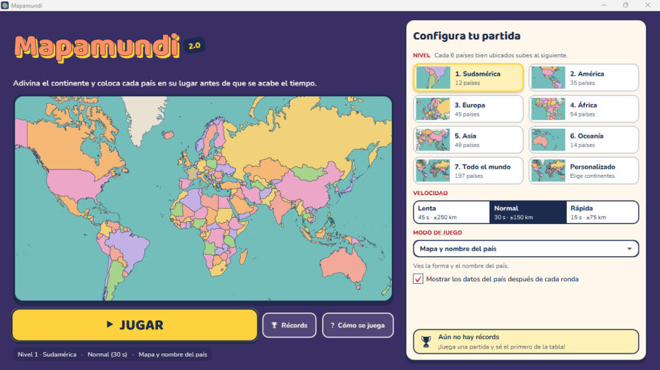
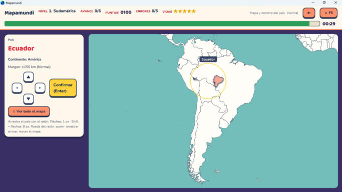

# Mapamundi 2.0 (Java)

Nueva versión del juego **Mapamundi** (Visual FoxPro, año 2000), ahora como aplicación de escritorio en
**Java 25 + JavaFX**, con un **mapa propio dibujado a partir de las fronteras reales** de Natural Earth
(sin internet y sin nombres que delaten la respuesta) y los **197 países actuales**.



> **Rama `version-sencilla` (Mapamundi Sencillo 3.0.0, en pruebas).** Una versión aparte, más simple, que vuelve
> a la forma de jugar del original. Al abrirla, primero se elige el idioma, después **¿con qué continente quieres
> jugar?** y luego **¿qué reto quieres?**. El reto es uno de los cinco modos y, al elegirlo, empieza la partida.
> El país cae mientras eliges su continente, la pieza del mapa nunca se detiene y hay 5 errores. El tutorial
> no sale solo: está en la pestaña **«Aprende a jugar»**, siempre visible a la derecha. Se instala como un
> programa distinto («Mapamundi Sencillo»), así que convive con Mapamundi 2.3.0, que sigue en la rama `main`.

## Descargar e instalar (Windows 10/11, 64 bits)

1. Entra en **[Descargas (Releases)](https://github.com/guess-samuel2401/mapamundi/releases/latest)**.
2. Descarga una de las dos opciones:
   - **`Mapamundi-2.3.0-instalador.exe`** (recomendado): ábrelo y sigue el asistente. Crea accesos directos
     en el menú Inicio (y, si quieres, en el Escritorio) y se puede desinstalar desde
     *Configuración → Aplicaciones*. No pide permisos de administrador.
   - **`Mapamundi-2.3.0-windows-portable.zip`**: descomprímelo donde quieras y abre `Mapamundi\Mapamundi.exe`.
     No instala nada.
3. No hace falta tener Java: el programa lo lleva incluido. Tampoco necesita internet para jugar.

> **Aviso de Windows SmartScreen.** Como el programa no está firmado con un certificado comercial, Windows
> puede mostrar *"Windows protegió su PC"*. Pulsa **Más información → Ejecutar de todas formas**.



## Cómo se juega

Al abrir el programa: **idioma** → **configuración de la partida** (paso 1, con el tutorial encima) →
**inicio de partida** (paso 2) → juego.

- **Paso 1 · Configura tu partida:** el estilo («Arrastra y ubica» o «Cae y ubica», en dos tarjetas grandes), el nivel o los
  continentes (tarjetas con su mapa), el modo de juego (cinco opciones a la vista, con su explicación y su
  dificultad de ● a ●●●●●), las reglas extra y si se muestra la ficha del país.
  **Continuar** (o Enter) lleva al paso 2.
- **Paso 2 · ¡Todo listo!:** el mapa con los países de la partida en color, la ficha "Tu partida" con todo lo
  elegido, el récord a batir y el botón **JUGAR** (o Enter). **Cambiar configuración** (o Esc) vuelve al paso 1.
- Al salir de una partida (desde la pausa o al terminar) se vuelve al paso 2, con la configuración guardada.
- Récords, Logros, Cómo se juega (?) y Ajustes (⚙) están arriba a la derecha en los dos pasos.

En la partida:

1. **Continente:** aparece un país (nombre + silueta). Elige su continente con las flechas + Enter,
   las teclas 1–5 o un clic. Tienes 5 intentos: +100 puntos.
2. **Ubicación:** arrastra la pieza del país sobre el mapa en blanco y confirma antes de que acabe el tiempo.
   - Ratón: arrastrar la pieza. Arrastrar el mar mueve el mapa; la rueda hace zoom.
   - Teclado: flechas (1 px), Shift + flechas (8 px), Enter para confirmar.
   - Cruceta en pantalla (mantener pulsado repite).
3. La distancia se mide **en km reales** entre la pieza y su lugar. Dentro del margen: +500 y un bonus por
   los segundos sobrantes. Si fallas o se acaba el tiempo, pierdes un corazón ♥ (se rompe en el panel superior). Con los 5 corazones perdidos termina la partida.
4. Tras cada ronda se ve tu posición (●), la real (★) y los datos del país.
5. **F5**, P o Esc: pausa.

**Rachas y combos:** los aciertos seguidos multiplican los puntos de la ronda: ×2 desde el 4.º y ×3 desde el 8.º
(fallar reinicia la racha). El panel superior muestra la racha y lo que valdrá el próximo acierto.

**Pistas** (una de cada tipo por ronda; su costo se resta de los puntos de esa ronda):

| Pista | Fase | Qué hace | Costo |
|---|---|---|---|
| Descartar 2 | Continente | Tacha dos continentes equivocados (sin gastar intentos) | 50 |
| Zona | Mapa | Marca un círculo que contiene el país (sin que esté en el centro) | 100 |
| Vecinos | Mapa | Pinta y nombra los países con los que tiene frontera (o los 3 más cercanos, si es una isla) | 150 |

**Reglas extra** (se combinan entre sí, en *Configura tu partida*):

- **Contrarreloj:** 90 segundos para toda la partida y sin corazones; cada acierto suma 5 s. No hay bonus de
  tiempo por ronda, pero sí combos.
- **Frío o caliente:** mientras arrastras, la pieza brilla de azul a rojo según lo cerca que esté y un rótulo lo
  dice ("Helado", "Frío", "Templado", "Caliente", "¡Te quemas!").
- **Pieza girada (modo experto):** la pieza aparece girada entre 45° y 180°; se endereza de 15° en 15° con
  **Q / E**, los botones ⟲ ⟳ o el clic derecho (Shift + clic derecho gira al revés). Solo vale si queda derecha,
  y cada acierto da +250 extra.

**Tiempo y margen:** 30 s por país, ±150 km de margen y un bonus de 20 puntos por cada segundo sobrante. Ya no se
elige la velocidad: todas las partidas (modernas y clásicas) tienen el mismo ritmo.

**Niveles:** Sudamérica → América → Europa → África → Asia → Oceanía → Todo el mundo
(cada 6 países bien ubicados se sube de nivel), o escoger los continentes a mano.

**Modos** (los del original): Mapa y nombre del país · Mapa y nombre de la capital · Solo nombre del país ·
Solo nombre de la capital · Solo datos del país.

### Estilo «Cae y ubica» (como el original del 2000)

En *Configura tu partida* se elige el estilo: **Arrastra y ubica** (todo lo anterior) o
**Cae y ubica**, que recrea la jugabilidad del Mapamundi original a partir de su código fuente en Visual FoxPro
(`frmprincipal`, `frmafrica`… y `errores.prg`):

1. **El país cae** desde arriba, un paso por tic y con un "bip" (cada 450 ms, el ritmo de la velocidad "Normal"
   del original).
   Hay que elegir su continente antes de que llegue abajo: ← → y Enter, las teclas 1–5, o clic para marcar y
   doble clic para elegir.
2. **En el mapa, la pieza no se detiene:** sale de arriba y del centro bajando despacio (al 60 % del ritmo
   original, para dar tiempo a pensar); las flechas cambian su dirección y, **mientras están pulsadas**, la pieza
   va más rápido (160 %); al soltarlas sigue en esa dirección, otra vez despacio. Rebota en los bordes y
   **Ctrl + flecha** la mueve muy rápido. Enter la suelta: vale si cae sobre el país
   (o a menos de 150 km, para los países diminutos). Una barra de tiempo se llena en unos 38 s.
3. **5 errores para toda la partida** (continente equivocado, país que llega abajo, pieza mal soltada o tiempo
   agotado); tras un error el **mismo país** vuelve a caer.
4. Cada país vale **10, 20, 30, 40 o 50 puntos** según el modo (de "Mapa y nombre del país" a "Solo datos"), sin
   bonus de tiempo. Cuando están todos los países de un continente sale **¡Mapa completo!** y ese continente se
   apaga; completar todos los elegidos gana la partida.

Como en el original, se eligen los continentes con los que jugar, la ficha del país se ve durante la jugada si
"Mostrar los datos del país" está marcado, y en los modos sin forma («Solo nombre…» y «Solo datos») la pieza
es un círculo (lo único que cambia es su color, el del país en el mapa) que no delata la silueta del país. Las reglas extra, las pistas y las insignias son solo del estilo «Arrastra y ubica».

### Idioma y tutorial

Cada vez que se abre el programa, lo primero es elegir el **idioma: español o inglés** (con un clic, ← → y Enter,
o las teclas 1 y 2; viene marcado el último usado). Después aparece el **tutorial animado** de 14 pasos,
en cuatro capítulos (introducción, «Arrastra y ubica», «Cae y ubica» y controles) a los que se salta con las
pestañas de arriba. Cada paso tiene una pequeña animación: el continente que se elige, la pieza que se arrastra
hasta su lugar, la racha con el ×2 y el ×3, las tres pistas, las reglas extra, las insignias, el país que cae
y la pieza clásica que nunca se detiene. Se navega con ← → y Enter, se cierra con Esc y se puede volver a ver
desde el botón **?** o desde Ajustes. Durante la primera partida salen, además, consejos breves en la parte de
abajo.

Todo el juego está traducido: menús, reglas, logros y los datos de los 197 países (nombres, capitales, idiomas,
monedas, religión y exportaciones; las cifras se muestran con el formato de cada idioma). Los textos de la
interfaz están en `src/main/resources/com/mapamundi/i18n/textos_es.properties` y `textos_en.properties`.

### Logros e insignias

25 insignias de bronce, plata y oro: rachas de 5, 10 y 20 aciertos seguidos, puntería (a menos de 25 km),
rapidez (menos del 20 % del tiempo, y menos de 3 segundos), capitales, modo "solo datos", completar un nivel sin fallar, 10 países en una partida contrarreloj,
10 aciertos con la pieza girada, llegar a niveles y puntuaciones, ubicar 25, 100 o los 197 países y completar
cada continente. Se ven en **★ Logros** (arriba a la derecha en la configuración y en el inicio), con el avance de
las que faltan; al conseguir una aparece un aviso durante la partida y un resumen al final.

### Ajustes (⚙)

- **Música de fondo** (una para el menú y otra, más tranquila, para la partida) y volumen de música y efectos
  por separado. El botón de sonido del panel superior silencia todo.
- **Pantalla completa** (también con **F11**).
- **Modo daltónico:** paleta de colores distinguibles con daltonismo (Okabe-Ito) y una trama distinta en cada
  color de país, para no depender solo del color. El verde y el rojo de acierto/fallo pasan a azul y naranja.

Todo se guarda en `%USERPROFILE%\.mapamundi\`: `preferencias.json` (ajustes y último idioma), `logros.json`
y `puntajes.json` (las 10 mejores puntuaciones).

## Ejecutar

Requiere un JDK 25 (el proyecto trae Maven Wrapper, no hace falta instalar Maven).

```bash
.\mvnw.cmd clean compile javafx:run
```

(`javafx:run` por sí solo no compila. Y si VS Code y Maven compilan a la vez en `target/classes`
puede quedar una clase corrupta — "Extra bytes at the end of class file" —, por eso conviene el `clean`.)

En **VS Code** (con el *Extension Pack for Java*):
- Pestaña *Ejecutar y depurar* → **Jugar Mapamundi**, o
- `Ctrl+Shift+B` → tarea **Jugar (Maven)**.

Pruebas: `.\mvnw.cmd test` (o la tarea **Pruebas**).

Para probar con datos ficticios sin tocar los reales, apunta estas variables de entorno a otros archivos JSON
antes de abrir el juego: `MAPAMUNDI_PUNTAJES` (récords), `MAPAMUNDI_LOGROS` (insignias) y
`MAPAMUNDI_PREFERENCIAS` (ajustes e idioma):

```bash
$env:MAPAMUNDI_PUNTAJES = "C:\ruta\puntajes-de-prueba.json"; .\mvnw.cmd compile javafx:run
```

## Programa de escritorio (Windows)

```bash
.\empaquetado\empaquetar.ps1 -Instalar
```

1. Compila el juego y reúne sus librerías en `target\programa`.
2. Con **jpackage** (incluido en el JDK) crea `target\instalador\Mapamundi\Mapamundi.exe`, con su propio Java
   recortado a los módulos que usa (~89 MB): funciona en equipos sin Java instalado.
3. Con `-Instalar`, lo copia a `%LOCALAPPDATA%\Programs\Mapamundi` (no necesita permisos de administrador)
   y crea accesos directos en el Escritorio y en el menú Inicio.

Para llevarlo a otro equipo basta con copiar la carpeta `target\instalador\Mapamundi` entera.

Para publicar una versión nueva (requiere [Inno Setup 6](https://jrsoftware.org/isinfo.php)):

```bash
.\empaquetado\empaquetar.ps1 -Publicar
gh release create v2.3.0 target\publicar\* --title "Mapamundi 2.3.0"
```

`-Publicar` deja en `target\publicar` el instalador (`empaquetado/instalador.iss`) y el ZIP portable.
Para desinstalarlo: borrar esa carpeta de Programs y los dos accesos directos (los puntajes están en `%USERPROFILE%\.mapamundi`).

El icono (`empaquetado/mapamundi.ico`) se genera con `python -I herramientas/crear_icono.py`.

## Estructura

```
src/main/java/com/mapamundi/
  App.java, Lanzador.java     arranque (Lanzador permite el botón Run de VS Code)
  geo/                        Mercator (proyección de OpenStreetMap), regiones y formas de los países
  i18n/                       idiomas: Idioma (español/inglés) y Textos (lee i18n/textos_*.properties)
  modelo/                     Continente, Pais, Atlas (carga datos/paises.json)
  juego/                      reglas y estado de la partida (sin interfaz: se prueba con JUnit);
                              Partida (estilo moderno) y PartidaClasica (el juego de 2000)
  ui/                         pantallas JavaFX (idioma, configuración, inicio de partida, fases, resultado, fin)
  ui/mapa/                    dibujo del mapa en Canvas, zoom, arrastre
src/main/resources/com/mapamundi/
  datos/paises.json           generado (fronteras + datos)
  sonidos/                    efectos de sonido (generados con herramientas/crear_efectos.py)
  musica/                     música de fondo (generada con herramientas/crear_musica.py)
  estilos.css                 colores del original
herramientas/                 scripts de Python para generar los datos
```

### Detalles del mapa

- Proyección **Web Mercator**, la misma de OpenStreetMap.
- Los países que cruzan el antimeridiano (Rusia, Fiyi, Kiribati…) se recomponen para que no se partan.
- La pieza de cada país es su "núcleo": se excluyen las islas a más de 1.100 km del resto
  (por ejemplo, la Guayana Francesa no forma parte de la pieza de Francia), aunque sí se dibujan en el mapa.
- Sáhara Occidental y las dependencias (Groenlandia, Puerto Rico…) se dibujan como tierra, pero no se juegan.

## Regenerar los datos

Necesita Python 3. Descarga las fronteras de Natural Earth en `herramientas/fuentes/`:

- `ne_50m_admin_0_countries.geojson` de <https://github.com/nvkelso/natural-earth-vector/tree/master/geojson>

y ejecuta (la ruta es la tabla del juego original):

```bash
python -I herramientas/actualizar_datos.py      # datos actuales de Wikidata -> herramientas/datos_wikidata.json
python herramientas/actualizar_ingles.py        # capital, idioma y moneda en inglés -> herramientas/datos_wikidata_en.json
python -I herramientas/construir_datos.py "D:\Fuente Globalizacion\mapamundi\paises.DBF"
```

Para la versión en inglés, `construir_datos.py` toma los nombres de los países de Natural Earth (`NAME_EN`), la
capital, el idioma y la moneda de `datos_wikidata_en.json`, y la religión y las exportaciones (textos del juego
de 2003) de `herramientas/traducciones_en.json`. Si aparece un texto nuevo sin traducir, el script lo avisa.

`actualizar_datos.py` consulta Wikidata (licencia CC0) y guarda capital, población, superficie, idiomas oficiales,
moneda y PIB nominal (el PIB per cápita se calcula con la población). Si a un país le falta un dato, se usa el del
juego original. La religión y las exportaciones siguen siendo las del juego de 2003 y la ficha lo indica.

La música de fondo (`src/main/resources/com/mapamundi/musica/`) es original, sintetizada con
`python herramientas/crear_musica.py` (necesita numpy); los bucles están mezclados para repetirse sin corte.

Los efectos de sonido (`src/main/resources/com/mapamundi/sonidos/`) también son originales: los sintetiza
`python herramientas/crear_efectos.py` con los mismos timbres y la misma tonalidad (do mayor) que la música.
Hay uno para cada momento: continente correcto o equivocado, país ubicado o mal ubicado, fin del tiempo,
fin de la partida, nivel superado, insignia conseguida y el "bip" del estilo clásico.

## Créditos

- Fronteras: [Natural Earth](https://www.naturalearthdata.com/) 1:50m, dominio público.
- Capital, población, superficie, idiomas, moneda y PIB: [Wikidata](https://www.wikidata.org/) (CC0).
- Religión, exportaciones e imágenes de referencia: Mapamundi original (2000–2003).
- Música y efectos de sonido: composiciones originales del juego, sintetizadas por código.
- Tipografías: [Baloo 2](https://github.com/EkType/Baloo2) (títulos y números) y
  [Nunito](https://github.com/googlefonts/nunito) (texto), licencia SIL Open Font License 1.1
  (`src/main/resources/com/mapamundi/fuentes/OFL-*.txt`). Los archivos estáticos vienen de Fontsource y
  `herramientas/renombrar_fuentes.py` ajusta sus nombres internos para que JavaFX los reconozca.

## Sistema visual

| Uso | Color |
|---|---|
| Fondo de la app ("uva") / mar del mapa | `#3A2F66` / `#74BEBC` |
| Paneles (papel) | `#FFF7EC` |
| Texto / texto secundario | `#1D2B4F` / `#4A5878` |
| Logotipo | coral `#FF8F6B`, contorno `#1A1433`, sombra `#FFD23F` |
| Títulos / rojo para texto pequeño | `#E3263B` / `#B3132A` |
| Acción principal y selección | `#FFD23F` (claro `#FFF1B8`) |
| Acento (botones secundarios, panel superior) | `#FF8F6B` |
| Países (atlas, sin celestes para no confundirse con el mar) | `#F4A99B` `#F3D27A` `#A9D38C` `#EDA7C9` `#C4B0E6` `#F6B878` `#D2BF94` |

Escala tipográfica: 12 · 14 · 16 · 20 · 28 · 40 · 64 px.

`docs/opciones-de-color.png` muestra las cuatro combinaciones de fondo y título que se compararon (se eligió la C, "Uva").
